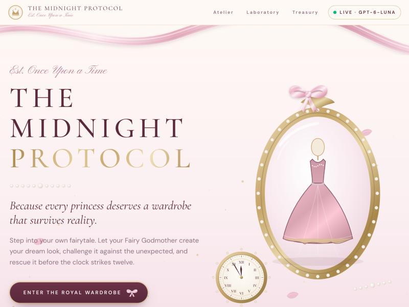

# The Midnight Protocol 👑

**Your Fairytale. Your Wardrobe. Your Happily Ever After.**

A multi-agent AI stylist that builds a princess-inspired outfit within a real budget, lets an adversarial agent throw a realistic problem at it (sold-out gown, rain, a 20-minute walk, a budget cut), and then repairs only what broke. Every number is checked by code before the user sees it.



---

## Quick start (under 5 minutes)

Requirements: **Node.js 18.18 or newer** (check with `node -v`). Nothing else.

```bash
git clone <this-repo-url> midnight-protocol
cd midnight-protocol
npm install
npm start
```

Then open **http://localhost:8787**.

`npm start` builds the website and starts the server. The terminal prints which mode is running and which `.env` file was found.

### API key

The app looks for a `.env` file **in the repo folder first, then in the folder one level above it**. Only one key is needed:

```
PORTKEY_API_KEY=...        # Portkey gateway key, uses gpt-6-luna
```

`.env.example` lists every optional setting: model name, token prices, safety caps and port. If no key is found, the app still runs in a clearly labeled **Demo mode**. In demo mode, rule-based agents stand in for the AI, and the interface says so on every screen. Demo output is never presented as live AI.

### Other commands

| Command | What it does |
|---|---|
| `npm start` | Build and serve the app on port 8787 |
| `npm run dev` | Development mode with hot reload (web app on :5173, API on :8787) |
| `npm run eval` | **Royal Laboratory**: 20 scenarios, Royal Council vs single-agent baseline, writes `eval/results/latest.json` |
| `npm run eval -- --limit 5` | Quick evaluation on the first 5 scenarios |
| `npm run test:safety` | Runs the 8 safety-defense tests (no API key needed) |

Screenshots of every screen from a live run are in [`docs/screenshots/`](docs/screenshots/).
| `node data/build-catalog.mjs` | Regenerates `data/catalog.json` from its compact source table |

---

## How it works

```
User preferences ─► Fairy Godmother (LLM) ─► Royal Treasurer (code) ──► approved outfit
                         ▲                        │ rejects with itemized feedback
                         └──── revise (≤ 2) ──────┘   (≤ 2 revisions, then labeled fallback)

approved outfit ─► Wicked Stepmother (code) ─► crisis + new constraints
                                                     │
                     impact analysis (code): which pieces broke? what must be added?
                                                     ▼
                         Midnight Guardian (LLM) ─► validator (code) ─► rescued outfit
                                 ▲                       │ rejects (≤ 2 attempts)
                                 └───────────────────────┘  or honest "no feasible outfit"
```

| Agent | Type | Responsibility |
|---|---|---|
| **Fairy Godmother** | LLM (gpt-6-luna) | Interprets the princess aesthetic and preferences. Picks catalog IDs only from a deterministic shortlist. Returns JSON with reasons. |
| **Royal Treasurer** | Deterministic code | Prices, availability, budget math, dress code and comfort rules. Sends itemized feedback and cheaper alternatives to the Godmother. |
| **Wicked Stepmother** | Deterministic scenarios | 8 reproducible crises. Proposes the one that actually threatens *this* outfit, or picks a seeded random one. |
| **Midnight Guardian** | LLM + validator | Changes only the affected pieces (plus budget-forced swaps), keeps the aesthetic, explains the trade-offs, and refuses when no valid outfit exists. |

Agents pass **structured JSON** that is validated with `zod` schemas. The UI's "Council Chamber" streams the real server events (NDJSON) as they happen, so every status message is an actual workflow step.

### Why two agents are code, not LLMs

Budget arithmetic and availability are facts, not opinions. Keeping them in code makes them exact, free, instant and impossible to talk into a wrong answer. The language model handles only the creative, judgment-heavy parts: choosing pieces that look right together and explaining them.

---

## Midnight Survival Score (rubric)

Each outfit is scored 0–100 on four dimensions at three moments: before the crisis, at midnight, and after the rescue.

| Dimension | How it's computed | Type |
|---|---|---|
| Princess aesthetic | Per item: 1.0 if tagged for the princess *and* matches the preferred style; 0.85 if princess only; 0.6 if style only; 0.3 otherwise. Averaged. | Rule-based |
| Budget compliance | 100 if total ≤ budget; otherwise ≤ 60, scaled by budget ÷ total | Hard rule |
| Occasion suitability | Clothing and shoes: 1.0 if tagged for the occasion, else 0.4; −25 per dress-code violation | Rule-based |
| Practicality & comfort | Share of active comfort and weather checks passed (no heels, walkable, modest, rain or cold ready) | Hard rules |

**Hard constraints override everything.** An invalid ID, an unavailable item, going over budget, a missing role, the wrong dress code or a failed comfort or weather rule marks the outfit **FAIL** and caps the overall score at 49. The AI's own aesthetic ratings are shown separately and labeled as *AI opinion*.

---

## Safety defenses

| Risk | Defense | Proof |
|---|---|---|
| Prompt injection / data leaks | Free-text wardrobe notes are sanitized, scanned for instruction patterns and withheld if flagged. Notes are passed as delimited *untrusted data*. The API key stays on the server only. | `npm run test:safety`, Laboratory page |
| Invented products or prices | The LLM outputs only IDs. Prices, names and availability always come from the catalog. Unknown IDs are rejected. | Same |
| Wrong actions (over budget, sold out) | The deterministic validator gates every outfit, and a failure triggers revision or an honest refusal | Same |
| Fake success | The Guardian proves infeasibility with an exact cheapest-outfit calculation and shows "Even magic has its limits" | Same |
| Infinite loops / runaway spending | Max 6 LLM calls per request, ≤ 2 revisions per agent, 60 s timeout per call, daily spend cap (`DAILY_SPEND_CAP_USD`), per-IP rate limit | Same |
| Malformed output | `zod` schema validation, and the error is fed back for one retry | Ledger shows `Valid JSON: no` attempts |

---

## Tokenomics

Every LLM call is appended to `logs/usage.jsonl` with the **API-reported** `prompt_tokens`, `cached_tokens` and `completion_tokens`, plus latency and cost. The **Royal Treasury** page shows per-agent costs, cost per journey, per user per month, and projections for 100 and 10,000 users. Prices are configurable in `.env` (`PRICE_*`). Set them to your model's published prices; the page shows where the prices came from.

Cost-cutting built in:
- **Deterministic shortlist.** The Godmother sees about 30 eligible items in a compact one-line format instead of all 79.
- **Prompt caching.** Every agent call starts with the same fixed catalog message, about 3,500 tokens, so repeat calls are billed at the cached-input rate. Measured over the 20-scenario run: about 3,400 of 3,800 styling input tokens were cached, and styling cost fell 21%. Turn it off with `PROMPT_CACHE=off` to compare.
- **Two of four agents cost nothing** because they're code.
- The Guardian sees **only candidates for the broken roles**.
- **Infeasible rescues are detected in code**, without spending an LLM call.

---

## Data

`data/catalog.json` holds **79 demonstration products** in 8 categories: dresses, tops, skirts, trousers, shoes, bags, jewelry and outerwear. Two of them are deliberately sold out. **Products and prices are illustrative and not sold by any real retailer.** Item images are original SVG illustrations drawn in code, so nothing can fail to load.

The catalog is small. To use a different catalog, replace `data/catalog.json` with a file using the same fields, or edit the table in `data/build-catalog.mjs` and run `node data/build-catalog.mjs`.

## Project structure

```
server/           Express API, agents, rules engine, LLM client, ledger, safety
  agents/         godmother.ts · treasurer.ts · stepmother.ts · guardian.ts · baseline.ts
  rules.ts        validation, survival score, exact solver
  crises.ts       the 8 reproducible crises
  orchestrator.ts the Royal Council workflow
shared/           zod schemas, types, princess definitions (used by server + UI)
src/              React + TypeScript + Tailwind + Framer Motion UI
data/             demo catalog
eval/             scenarios.json, run.ts (Royal Laboratory), safety.test.ts, results/
```

## Limitations

- The catalog is a demonstration dataset, not live retail inventory.
- Sizes are stored but not yet used as a constraint.
- Aesthetic scoring is rule-based (tags). It doesn't judge real visual harmony.
- Crises are predefined, not open-ended.

## Accessibility

Keyboard navigable, semantic roles and labels, visible focus rings, `prefers-reduced-motion` respected (animations off), color is never the only signal, and layouts are responsive down to 375 px.
